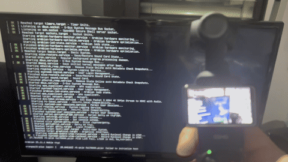

# DJI Osmo Pocket 3 → HDMI 4K Streaming


Hardware-accelerated H264 streaming from DJI Osmo Pocket 3 to HDMI with Rockchip MPP decoder.

## 🎥 Demo Video



*Live streaming from DJI Osmo Pocket 3 to HDMI display via Orange Pi 5 Plus*

📹 [Watch full quality video (MP4, 18 MB)](https://github.com/stephanebhiri/DJI_OSMOPOCKET3_TO_HDMI_4K_60P_50P/raw/main/demo/OSM0_ORANGEPI_TO_HDMI1080i50.mp4)

**✅ Tested & Working (2026-01-08)**
- Orange Pi 5 Plus (RK3588)
- Ubuntu Noble 24.04 (Armbian) / GStreamer 1.24
- Kernel 6.1.115-vendor-rk35xx
- 4K 50fps → Hardware decode → HDMI 1080i@50
- CPU: ~43%, Latency: <100ms, Stable

---

## Images Orange Pi 5 Plus

**Images retirées le 24 octobre 2026.** Les anciennes images v1.0 et v2.0 ne sont plus téléchargeables. Les images v2.0 ne contenaient pas le son de la Pocket 3 et utilisaient un numéro de mode EDID fixe qui a empêché le retour de la vidéo après redémarrage sur le matériel de test. Une installation personnelle corrigée sur eMMC est documentée dans [la procédure BELABOX](image/BELABOX_EMMC_RUNBOOK_FR.md) et [son compte rendu matériel](image/BELABOX_VALIDATION_2026-10-26.md). Aucune nouvelle image publique n'est publiée.

Les anciennes variantes étaient une image de démarrage microSD et une image d'installation eMMC. Cette dernière effaçait entièrement l'eMMC. Leur fonctionnement et leurs limites restent documentés dans [les instructions historiques](image/DUAL_IMAGES.md).

---

## 🎯 Two Ways to Use This Project

### Option 1: 🖼️ **Ancienne image v1.0 (archive)**

Cette section décrit la version de janvier 2026, retirée des téléchargements publics. Elle ne sert que de référence historique si vous possédez déjà le fichier.

**⏱️ 5 minutes setup** - Just flash and go!

1. **Use an existing local copy** of `dji-noble-v1.0-20260108.img.gz` (893 MB). This image is no longer published.

2. **Flash with Etcher**:
   - Download [Balena Etcher](https://etcher.balena.io/)
   - Select image → Select SD card (≥4 GB) → Flash!

3. **Boot & Use**:
   - Insert SD card in Orange Pi
   - Connect HDMI display
   - Power on (wait 1 minute for first boot)
   - Plug DJI → Video works! 🎉

**Default credentials:**
- User: `orangepi` / `orangepi`
- Root password: `orangepi`
- SSH: ✅ Enabled

**Image includes:** Everything pre-configured (OS, drivers, service, boot config)

📖 **Full instructions:** [IMAGE_README.md](IMAGE_README.md)

---

### Option 2: 🛠️ **Install from Scratch** (Advanced)

**⏱️ 20-30 minutes** - Build it yourself

1. **Flash Ubuntu Noble 24.04**:
   - Download [Armbian Noble Minimal](https://www.armbian.com/orangepi-5-plus/)
   - Flash to SD card (≥8 GB recommended)

2. **Run automated install**:
   ```bash
   git clone https://github.com/stephanebhiri/DJI_OSMOPOCKET3_TO_HDMI_4K_60P_50P.git
   cd DJI_OSMOPOCKET3_TO_HDMI_4K_60P_50P
   sudo ./install-noble.sh
   sudo reboot
   ```

3. **Use**:
   - Plug DJI → Video works! 🎉

📖 **Full instructions:** [WORKING_CONFIG_NOBLE.md](WORKING_CONFIG_NOBLE.md)

---

## ⚠️ Important: OS Compatibility

| OS | GStreamer | Status | Notes |
|----|-----------|--------|-------|
| **Ubuntu Noble 24.04** | 1.24.2 | ✅ **WORKS** | Recommended! |
| **Debian Bookworm** | 1.24.x | ✅ **WORKS** | Also compatible |
| **Debian Trixie** | 1.26.x | ❌ **FAILS** | Incompatible with libuvch264src |

**Why?** The BELABOX fork of libuvch264src (Jan 2025) was built for GStreamer 1.24. Trixie's GStreamer 1.26 has API changes that break compatibility.

---

## 📊 Technical Specs

### What's Included

- **OS**: Ubuntu Noble 24.04 (Armbian)
- **Kernel**: 6.1.115-vendor-rk35xx
- **GStreamer**: 1.24.2
- **Video decoder**: Rockchip MPP (hardware)
- **H264 source**: libuvch264src (BELABOX fork)
- **Display**: KMS sink (plane-id=73)
- **Service**: systemd auto-start

### Performance

| Metric | Value |
|--------|-------|
| Input | 4K 50fps (3840x2160@50) |
| Output | 1080i 50Hz (HDMI) |
| CPU Usage | ~43% (hardware decode) |
| RAM Usage | ~92 MB (stable) |
| Latency | < 100ms |

### Compatibility

**SD Card Sizes (with ready-to-use image):**
- ✅ 4 GB - Minimum (auto-expands)
- ✅ 8 GB - Recommended
- ✅ 16 GB - Great
- ✅ 32-64 GB - Optimal
- ❌ 2 GB - Too small

**DJI Cameras:**
- ✅ DJI Osmo Pocket 3 (tested)
- ⚠️ Other DJI cameras may work (not tested)

---

## 📖 Documentation

### Getting Started
- **[IMAGE_README.md](IMAGE_README.md)** - Using the pre-built image
- **[WORKING_CONFIG_NOBLE.md](WORKING_CONFIG_NOBLE.md)** - Installing from scratch on Noble

### Advanced
- **[CREATE_IMAGE.md](CREATE_IMAGE.md)** - How to create your own image
- **[prepare-image.sh](prepare-image.sh)** - Clean system for distribution
- **[GPIO_BUTTON_GUIDE.md](GPIO_BUTTON_GUIDE.md)** - HDMI mode toggle with physical button

### Legacy/Reference
- **[WORKING_CONFIG.md](WORKING_CONFIG.md)** - Old Bookworm config
- **[TEST_ON_FRESH_ORANGEPI.md](TEST_ON_FRESH_ORANGEPI.md)** - Original test notes

---

## 🔧 Quick Commands

### Check service status
```bash
sudo systemctl status dji-h264-stream.service
```

### View logs
```bash
sudo journalctl -u dji-h264-stream.service -f
```

### Check DJI connected
```bash
lsusb | grep -i dji
# Should show: Bus 001 Device XXX: ID 2ca3:0023 DJI Technology Co., Ltd. DJIPocket3
```

### Restart service
```bash
sudo systemctl restart dji-h264-stream.service
```

### Test HDMI output
```bash
gst-launch-1.0 videotestsrc ! kmssink plane-id=73 connector-id=215
```

---

## 🐛 Troubleshooting

### No video on HDMI

1. **Check service running:**
   ```bash
   sudo systemctl status dji-h264-stream.service
   ```

2. **Check DJI connected:**
   ```bash
   lsusb | grep 2ca3
   ```

3. **Check logs for errors:**
   ```bash
   sudo journalctl -u dji-h264-stream.service -n 50
   ```

4. **Verify HDMI display connected before boot**

### Service keeps restarting

Check logs for specific errors:
```bash
sudo journalctl -u dji-h264-stream.service -f
```

Common issues:
- DJI not plugged in (service waits)
- Wrong video mode on DJI
- USB cable issue
- Insufficient power supply

### DJI not detected

```bash
# Check USB devices
lsusb

# Check USB permissions
ls -la /dev/bus/usb/001/

# Reload udev rules
sudo udevadm control --reload-rules
sudo udevadm trigger

# Replug DJI camera
```

### Still having issues?

1. Check [IMAGE_README.md](IMAGE_README.md) troubleshooting section
2. Check [WORKING_CONFIG_NOBLE.md](WORKING_CONFIG_NOBLE.md) for detailed config
3. [Open an issue](https://github.com/stephanebhiri/DJI_OSMOPOCKET3_TO_HDMI_4K_60P_50P/issues) with logs

---

## 🎛️ Optional: GPIO Button for HDMI Mode Toggle

**⚠️ Not included in the ready-to-use image** - Install separately if needed

Toggle between 1080i50 (interlaced) and 1080p50 (progressive) with a physical button.

```bash
chmod +x install-gpio-button.sh
./install-gpio-button.sh
```

**Wiring:** Pin 7 (GPIO3_A4) ──── Button ──── GND

📘 Full guide: [GPIO_BUTTON_GUIDE.md](GPIO_BUTTON_GUIDE.md)

---

## 🔗 Downloads & Resources

- **📥 Ready-to-Use Image**: [GitHub Releases](https://github.com/stephanebhiri/DJI_OSMOPOCKET3_TO_HDMI_4K_60P_50P/releases/latest)
- **📖 Source Code**: [GitHub Repository](https://github.com/stephanebhiri/DJI_OSMOPOCKET3_TO_HDMI_4K_60P_50P)
- **🐛 Bug Reports**: [GitHub Issues](https://github.com/stephanebhiri/DJI_OSMOPOCKET3_TO_HDMI_4K_60P_50P/issues)

---

## 🏗️ Architecture

```
DJI Osmo Pocket 3 (USB-C)
    ↓ UVC H.264 stream (4K 50fps)
libuvch264src (BELABOX fork)
    ↓ H.264 packets
h264parse
    ↓ Parsed H.264
mppvideodec (Rockchip MPP hardware decoder)
    ↓ NV12 frames
kmssink (KMS/DRM direct display, plane-id=73)
    ↓
HDMI Output (1080i@50)
```

**Key components:**
- **libuvch264src**: Captures H.264 from DJI's proprietary UVC mode
- **Rockchip MPP**: Hardware H.264 decoder (low CPU usage)
- **kmssink**: Direct-to-framebuffer output (low latency)

---

## 🤝 Contributing

Contributions welcome!

- **Bug reports**: [Open an issue](https://github.com/stephanebhiri/DJI_OSMOPOCKET3_TO_HDMI_4K_60P_50P/issues)
- **Pull requests**: Feel free to submit PRs
- **Documentation**: Help improve docs
- **Testing**: Test on other hardware/cameras

---

## 📝 License

MIT License - See [LICENSE](LICENSE) file

---

## 🙏 Credits

- **[Armbian](https://www.armbian.com/)** - Base OS
- **[BELABOX](https://github.com/BELABOX/gstlibuvch264src)** - libuvch264src fork for DJI cameras
- **[Rockchip](https://github.com/rockchip-linux/mpp)** - MPP hardware decoder
- **[DrewSif/PiShrink](https://github.com/Drewsif/PiShrink)** - Image shrinking tool
- **[GStreamer](https://gstreamer.freedesktop.org/)** - Multimedia framework

---

## 🎉 Status

**✅ Production Ready** - Tested and stable on Orange Pi 5 Plus with DJI Osmo Pocket 3.

Last updated: 2026-01-08
